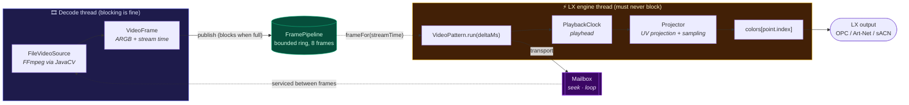

# 🧠 Architecture

## Packages

| Module | Package | Category in Chromatik | What it does |
|---|---|---|---|
| [`packages/chromatik-core`](../packages/chromatik-core) | `laserphile.chromatik.core` | no patterns of its own | The projection stage, the frame pipeline, and the bundled FFmpeg decode stack |
| [`packages/chromatik-video`](../packages/chromatik-video) | `laserphile.chromatik.video` | **Laserphile → Video** | Plays a video file onto the model |
| [`packages/chromatik-screen`](../packages/chromatik-screen) | `laserphile.chromatik.screen` | **Laserphile → Screen Capture** | Puts the live desktop onto the model |
| [`packages/chromatik-shader`](../packages/chromatik-shader) | `laserphile.chromatik.shader` | **Laserphile → Shader** | Renders a GLSL fragment shader onto the model |
| [`packages/chromatik-touch`](../packages/chromatik-touch) | `laserphile.chromatik.touch` | **Laserphile → Touch Camera**, **Touch Blob OSC** | Webcam-driven touch processing, calibration preview, and OSC blob output |
| [`packages/chromatik-transforms`](../packages/chromatik-transforms) | `laserphile.chromatik.transforms` | **Laserphile → Panel Transforms** | Calibration helper that applies yaw/pitch/roll edits directly to matching panel fixtures |
| [`packages/chromatik-mcp`](../packages/chromatik-mcp) | `laserphile.chromatik.mcp` | no patterns, a plugin | Lets an AI agent read and compose the show over MCP |

A Maven multi-module build, one module per Chromatik content package. Chromatik discovers packages by scanning `~/Chromatik/Packages/*.jar` for a root `lx.package` file, so one jar is exactly one package and every plugin needs its own module. The root `pom.xml` is the parent: it holds the compiler settings, the `provided` LX dependencies, the `lx.package` filtering, the shade config, and the install profile, so a new module is a ~15-line pom.

**Why a core package rather than a library each plugin bundles.** Chromatik hands every jar in its packages folder to one shared class loader, and registers every public class it finds against the package that supplied it, logging an error for any name it has already seen. That isn't limited to patterns: 328 of the 332 classes it registers are `org.bytedeco`. Two plugins each carrying FFmpeg would mean 328 errors the moment both were installed, and a second 43 MB download. So the decode stack lives in one jar and the plugins take it at `provided` scope, which is why they weigh 12 KB. The same shared class loader is what lets them find it at runtime.

The repo is named for what it's growing into. Sibling `laserphile.chromatik.*` packages land alongside these as they're built, see [`docs/ADDING-A-PLUGIN.md`](ADDING-A-PLUGIN.md).

## Features

- **Model-agnostic projection.** Works on any `LXModel`: domes, sculptures, strips, matrices. Nothing assumes a grid.
- **Never blocks the engine.** All decode and colour conversion happen off the LX engine thread. `run()` does a lock-free read and a tight per-point loop.
- **Full transport.** Play/pause, loop, 0.1x to 4x speed, and a two-way position slider you can scrub. Looping is gapless and scrubbing coalesces, so a fast drag doesn't queue up a hundred seeks.
- **Live screen capture.** A second pattern, **Screen Capture**, puts the desktop onto the LEDs in real time through the same projection controls. It keeps only the newest frame, so nothing buffers latency in between, and it carries no transport, because a live desktop has no playhead to move. Needs screen-recording permission for Chromatik.
- **Touch camera and OSC blob extraction.** `Touch Camera` and `Touch Blob OSC` share the same webcam pipeline, including gain/threshold baseline subtraction, circular masking, and orientation flips for mirrored camera rigs.
- **Built-in touch preview server.** The touch package logs a local preview URL and now prefers port `42070`, with automatic fallback to the next free local port if that port is in use.
- **Full projection control.** Yaw, pitch, roll, translate on three axes, scale, per-axis stretch, and scroll.
- **Four wrap modes.** `CLAMP`, `CLIP`, `TILE`, `MIRROR`, matching the vocabulary of the built-in `ImagePattern`.
- **Transparent background.** `CLEAR` lets lower LX layers show through where the image doesn't reach.
- **Bilinear sampling.** Cuts the shimmer you get when a sparse point cloud samples a small texture.
- **Native file chooser.** A `Browse` button opens the real OS open dialog, no typing paths. It opens on the current file's folder, or on the folder you browsed to last, and for shaders on the plugin's own folder where the demos live. Files under `~/Chromatik` are stored as relative paths so a shared project still finds them.
- **GLSL shaders, in whichever dialect they were written.** Processing-era files with no `#version` and Shadertoy files with no `main` both run untouched, because the loader wraps rather than rewrites. Each `uniform` becomes a knob, with its range taken from a trailing `@range` comment.
- **Live shader editing.** Save the file and it recompiles, no button. A save that will not compile leaves the previous shader running and reports the compiler's message rather than going dark.
- **FREE licence tier throughout.** No `LXPlugin` anywhere, which is what that tier gates. Shader supplies its own device panel by implementing `UIDeviceControls`, which Chromatik checks before it consults the plugin registry, so even the custom UI needs no licence.

## How it works

Two threads, one hand-off, no locks on the hot path.



The decode thread owns the FFmpeg grabber and pushes finished frames into a small bounded ring. The engine picks the newest frame that's due at the current playhead and leaves the rest. A full ring is the only brake on decoding, which makes back-pressure fall out for free: pausing or playing below 1x stalls the decode thread on the ring, and playing above 1x drains it so decode runs flat out to keep up. If decode still can't keep up, the engine re-projects the newest frame it has and the playhead carries on, so media time stays honest and frames are dropped instead.

Control flows the other way through a mailbox the decode thread reads between frames. Seeks coalesce to the newest target and carry a generation number, so a fast scrub never flashes footage from a position you've already dragged past. Looping happens entirely on the decode thread, so the seam is gapless: it stamps every frame with a timeline that keeps climbing straight through the loop point, which is the same timeline the playhead runs on.

Frames are decoded no larger than `Res` says. Video starts at 512; on `Auto`, the default elsewhere, the size comes from the model's point count. Sampling a few thousand points out of a 4K frame is wasted work, and the scaler is already converting every frame so resizing rides along in the same pass. What comes out is small enough to stay in cache while the projection walks it.

Colour is put right on the way out. Video stores brightness and two colour-difference channels, and turning those into red, green and blue needs one set of coefficients for standard-definition footage and another for high-definition. The file says which; JavaCV never passes that answer to the scaler, so every file is decoded as if it were standard definition. That costs up to 32 of 255 on a strongly coloured pixel and nothing at all on a grey one, which reads as a hue and saturation shift rather than as anything obviously broken. The scaler's error is a fixed linear mix of the RGB it produced, so it is undone with another one, per decoded pixel on the decode thread. A channel that arrives sitting on 0 or 255 is left alone: the scaler clamped it before we saw it, and correcting anyway lifts green off a pure magenta bar and turns it dirty.

<details>
<summary><b>The projection maths</b></summary>

Per point, in normalised model coordinates so nothing depends on the model's real-world size:

```
c = (xn-0.5, yn-0.5, zn-0.5) - (translateX, translateY, translateZ)
r = transpose(R) * c            // inverse-rotate into the texture plane
u = r.x * invScaleX + 0.5 + scrollX
v = r.y * invScaleY + 0.5 + scrollY
                                // r.z is dropped: the projection is orthographic
```

`R = Rz(roll) * Ry(yaw) * Rx(pitch)`, built once per frame in `ProjectionParams.recompute()` along with the reciprocal scales, so the per-point loop does no trig and no division.

`(u, v)` then goes through the wrap mode, and the result is sampled nearest or bilinear. Points that `CLIP` rejects take the background colour.

This is re-implemented from the documented behaviour of Chromatik's `ImagePattern`, not copied from it. Chromatik is proprietary; the algorithms aren't.

</details>

<details>
<summary><b>Source layout</b></summary>

**`packages/chromatik-core/src/main/java/laserphile/chromatik/core/`**, shared by every plugin and public only where a plugin actually reaches it:

| File | Thread | Role |
|---|---|---|
| `FrameSource.java` | decode | Interface. The seam that lets a file and a live screen share one pipeline and one projector. |
| `FramePipeline.java` | both | Owns the decode thread and the buffer: a ring for a file, one slot for a live source. Idempotent start/stop with a bounded join. |
| `VideoFrame.java` | both | A decoded frame plus its place on the timeline. |
| `ProjectionControls.java` | engine | The 16 projection controls every pattern shares, plus the snapshot-and-project call. |
| `ProjectionParams.java` | engine | Per-frame snapshot of the controls, with the rotation matrix and the tone curve precomputed. |
| `Projector.java` | engine | The per-point UV projection and sampling loop. Package-private: `ProjectionControls` is its only caller. |
| `ColorSpaceCorrection.java` | decode | Undoes the decoder's fixed BT.601 conversion on high-definition footage. |
| `WorkingResolution.java` | decode | How big to decode, and how to make a grabber produce that size. |

**`packages/chromatik-video/…/video/`** and **`packages/chromatik-screen/…/screen/`**, one pattern each:

| File | Thread | Role |
|---|---|---|
| `VideoPattern.java` | engine | Orchestrator for file playback. Owns the transport, drives the clock and pipeline. |
| `FileVideoSource.java` | decode | Wraps `FFmpegFrameGrabber`. Video track only, so the audio is never decoded or seeked. |
| `PlaybackClock.java` | engine | The playhead. Pure state: play, speed, and the pending seek target, no I/O. |
| `ScreenCapturePattern.java` | engine | Orchestrator for the live desktop. No transport, because there is no timeline. |
| `ScreenCaptureSource.java` | capture | The desktop through FFmpeg's per-OS capture device. Live, no timeline. |

</details>
